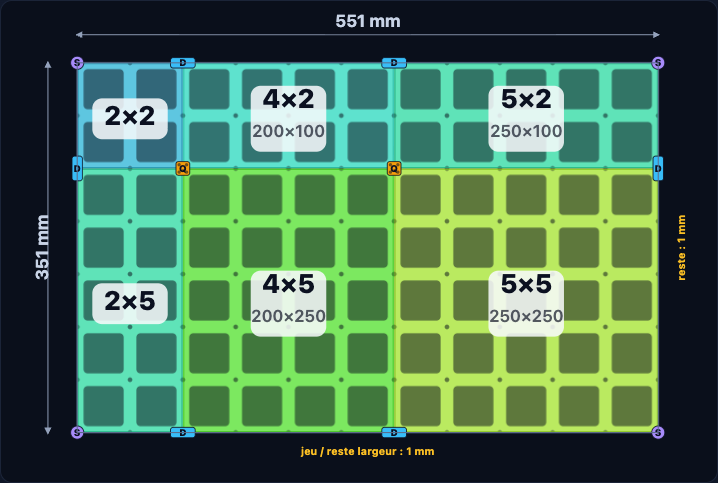
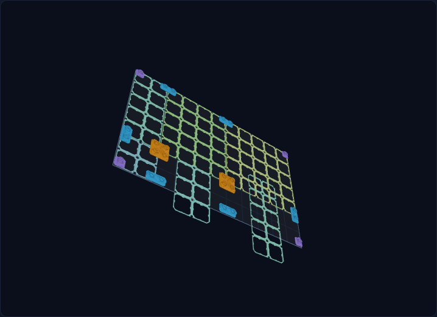

# MultiBin Drawer Planner

Un planificateur de tiroirs pour plaques **MultiBin / MultiBuild**, avec aperçu 2D, aperçu 3D des STL et export **3MF multi-plateaux** pour Bambu Studio / OrcaSlicer.



## Pourquoi ce projet ?

J'ai payé un abonnement **MultiBuild** pour accéder à leur générateur. J'ai été déçu de ce qui était proposé pour le prix : pas de vraie planification d'un tiroir à partir de ses dimensions, pas de symétrie, pas de gestion des bords pour remplir le tiroir, et pas d'export 3MF multi-plateaux. Il fallait bricoler les plaques une par une.

J'ai donc écrit l'outil que j'attendais : je saisis les dimensions de mon tiroir et de mon plateau, et j'obtiens directement la liste des plaques, leur disposition et un 3MF prêt à imprimer.

Je précise que j'aime le système MultiBuild/MultiBoard et que ce n'est **pas une attaque personnelle** : c'est simplement mon retour d'expérience sur l'outil payant, et une alternative pour mon usage.

## Fonctionnalités

- Dimensions intérieures du tiroir (largeur/profondeur) et jeu mini (alerte).
- Calcul de la grille en **CU de 50 mm**.
- Disposition optimisée par découpe guillotine (minimum de plaques).
- **Symétrie** gauche/droite et haut/bas, avec les plus petites plaques au centre quand la géométrie le permet.
- **Plaques de bord étendues** : une plaque d'une cellule plus grande est générée, coupée à la marge du tiroir, puis un **bord fin de 2,5 mm** est ajouté. Le motif continue naturellement : grands trous, petits trous aux nœuds, **filetage conservé**, sans pastilles ni cadre rapporté.
- Aperçu 2D avec le motif réel, les dimensions et les bords.
- **Aperçu 3D** des maillages STL réels dans l'app (rotation/zoom), sans passer par Orca.
- **Clips adhésifs S** (VHB Bolt-Lock) : choix « Aucun clip » / « Clips adhésifs S », comptage automatique **Quad / Dual / Single** aux angles des plaques, repères dans l'aperçu 2D, maillages réels dans la 3D, et ajout automatique sur les plateaux d'impression.
- Export **3MF projet multi-plateaux** Bambu Studio / OrcaSlicer.
- Export CSV et copie de la liste.
- Chargement automatique des plaques depuis un serveur local : pas d'import manuel.

## Plaques prises en charge

- **Square Plate** : 2×1 → 10×10 CU.
- **Base Plate** et **Lite Panel** : 2×2 → 10×10 CU, générées à partir d'une référence 3×3.

Limites : le 1×1 n'existe pas dans le générateur officiel ; les plaques Base/Lite ne sont pas générées en 1×N (le plan utilise des plaques ≥ 2×2). Une plaque de bord a besoin d'une plaque d'une cellule plus grande pour être coupée : une plaque 10×10 avec bord demanderait du 11×11, non disponible.

## Captures

| Planificateur 2D | Aperçu 3D |
|---|---|
|  |  |

## Ce qui n'est pas inclus

Les **STL et maillages** (plaques **et clips**) **ne sont pas distribués** dans ce dépôt :

- ils sont soumis à la licence MultiBuild ;
- le dépôt reste léger ;
- le script local qui pilote le générateur public n'est pas publié ici non plus. Utilise tes propres téléchargements / ton abonnement.

## Installation

Prérequis : Python 3 pour le serveur local, Node.js 20+ uniquement pour générer les plaques Base/Lite.

```bash
git clone https://github.com/Gromatou/multibin-drawer-planner.git
cd multibin-drawer-planner
npm install        # uniquement pour tile-plates.mjs (manifold-3d)
```

### 1. Fournir les plaques

**Square Plate** : télécharge les tailles dont tu as besoin depuis MultiBuild (avec ton compte), place les `.stl` dans `stls/square/`, puis :

```bash
node make-manifest.js
```

**Base Plate / Lite Panel** : place les deux références 3×3 dans `refs/` :

```
refs/3x3 CU - Multibin Base Plate.stl
refs/3x3 LU - Lite MultiBin Panel.stl
```

puis :

```bash
node tile-plates.mjs
```

Le script génère les tailles 2×2 → 10×10 dans `stls/base/` et `stls/lite/` (format `.mesh` optimisé) et écrit les manifests.

Tu peux aussi télécharger toutes les tailles et lancer `node make-manifest.js`.

### 1 bis. Fournir les clips (optionnel)

Place les trois STL du set **S** ici :

```
stls/clips/s/quad.stl
stls/clips/s/dual.stl
stls/clips/s/single.stl
```

J'utilise les **Bolt-Lock VHB Tape Mount** (6,25 mm) : quad 50×50, dual 25×50, single 25×25. Ces fichiers ne sont pas inclus dans le dépôt (licence MultiBuild). Pour ajouter les **XS** ensuite : crée `stls/clips/xs/` avec les trois STL et ajoute le set `xs` dans `CLIP_SETS` (`index.html`).

### 2. Lancer l'outil

```bash
./serve.command
```

ou :

```bash
python3 -m http.server 8765 --bind 127.0.0.1
```

Ouvre ensuite **http://127.0.0.1:8765/**.

## Utilisation

1. Saisis les dimensions **intérieures** du tiroir et le plateau de l'imprimante.
2. Choisis le type de plaque et la taille maximale.
3. Active éventuellement **Symétrie** et **Plaques de bord étendues**.
4. Choisis les **clips** (ou « Aucun clip »). Les quantités Quad/Dual/Single sont calculées aux angles des plaques.
5. Vérifie l'aperçu 2D, puis **Télécharger le 3MF multi-plateaux** (plaques + clips).
6. Pour voir les vrais maillages : **Afficher la vue 3D** (glisser pour tourner, molette pour zoomer).

Le 3MF ne contient volontairement pas de `project_settings.config` : dans Orca, il faut sélectionner le bon profil imprimante, et les dimensions de plateau saisies dans l'app doivent correspondre à celles du profil.

## Testé avec

- OrcaSlicer 2.5
- Bambu Studio 2.8
- Firefox et Chrome
- Maillages vérifiés `manifold = yes` dans Orca
- Clips S : quad / dual / single ajoutés au 3MF et visibles dans la 3D

## Licence et crédits

Le code de ce dépôt est sous licence **MIT** (voir `LICENSE`). Les bibliothèques tierces embarquées dans `vendor/` gardent leurs licences :

- **manifold-3d** : Apache-2.0 (`vendor/LICENSE-manifold`)
- **three.js** : MIT (`vendor/LICENSE-three`)

Les pièces MultiBuild/MultiBoard, leurs noms et leurs marques appartiennent à leurs propriétaires. Ce projet est **non officiel et non affilié** à MultiBuild/MultiBoard. Aucun contournement d'abonnement : l'outil organise uniquement les fichiers que tu as le droit d'utiliser.

## English TL;DR

I paid for a MultiBuild subscription and was disappointed by what the official paid tool offered for drawer planning. So I built this: drawer dimensions in, symmetric layouts, continuous edge plates with the real threaded grid, and a multi-plate 3MF export for Bambu/Orca. STLs are **not** included, by license and by design.
